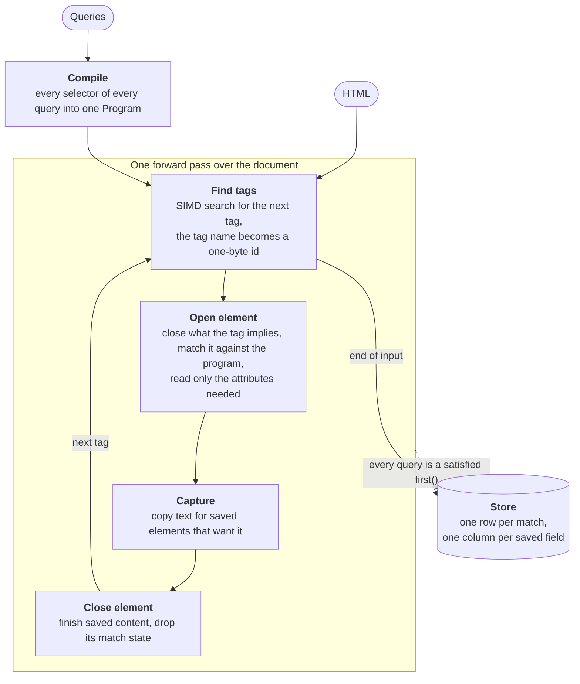

# Architecture

This guide explains how a parse works and which crate does what. You don't
need it to use scah, but it explains where the speed comes from and why some
selectors are not supported.

## The idea

Most HTML libraries parse a document into a tree, then run selectors over the
tree. scah inverts that: it compiles the selectors first, then makes a single
pass over the document and decides each element as its start tag is read.
Only matched elements are stored, so time and memory scale with the document
size and the number of matches, not the size of a tree.

Deciding at the start tag is what rules out selectors such as `:has()` and
`:last-child`: they depend on parts of the document the parser hasn't read
yet. See [Selector support](selectors.md).

## A parse, step by step

1. **Compile.** `Program::compile` numbers every compound selector of every
   query, nested query, and selector-list alternative, then lays out what the
   matcher needs as flat tables with one bit per selector step.
2. **Find tags.** The lexer jumps from tag to tag with SIMD byte searches. On
   large documents with long runs of text, it samples the input first and
   may index it ahead with a [simdlex](https://crates.io/crates/simdlex)
   structural tape, which is built lazily so an early exit only indexes what
   it read. Comments are skipped and `script`, `style`, and other raw-text
   elements are jumped over.
3. **Open an element.** The open-element stack applies HTML's recovery rules
   for void elements, implied end tags (an open `p`, `li`, `option`, or table
   cell closed by a new tag), and misnested end tags. The matcher then decides
   which selector steps the element satisfies. Attributes are parsed only if
   a candidate selector or a `Save` needs them.
4. **Capture.** While a saved element that wants text is open, text between
   tags is copied to the store's text tapes, normalizing it on the way when
   `text` is requested.
5. **Close an element.** The element's saved content gets its final range,
   and its match state is popped.
6. **Stop early.** If every query is a satisfied `first()`, the parse stops
   without reading the rest of the document.

## The matcher

The matcher is a bitset automaton. Each open element that carries useful
match state has a *frame* of a few bitsets, one bit per program step:

- **matched**: steps this element satisfies, read by `>` in its children;
- **inherited**: steps satisfied by this element or any ancestor, read by
  the descendant combinator;
- **previous sibling** and **any sibling**: steps satisfied by earlier
  siblings, read by `+` and `~`.

Opening an element shifts its parent's bits forward one step, masks them by
the combinator, and keeps the steps whose compound selector accepts the
element. The cost per tag is a few word operations no matter how many partial
matches exist. That is why deeply nested descendant chains and many
simultaneous queries stay fast.

Elements that add nothing to the match state don't get a frame at all: a run
of nested `div`s under `div p` costs one frame, not one per `div`.

Nested queries add *scopes*. When a parent query saves an element, it opens a
scope, and child queries match relative to the scopes they are inside. That
is how `.then()` keeps each child result attached to the right parent.

## The store

Results live in a columnar store. Each match is a row; each saved field (name,
attributes, inner HTML, raw text, text) is a column of 32-bit spans, and a
column exists only if some query saves that field. Names, attributes, and
inner HTML point into the input HTML; text points into a tape the parse
filled. `ElementRef` is a small handle to a row.

A dropped store keeps up to 32 MiB of its buffers for the next parse on the
same thread, so parsing many documents in a loop doesn't allocate a fresh
store each time.

## Crates

| Crate | Role |
| ----- | ---- |
| [`scah`](../crates/scah) | The public API, the parse loop, the matcher, and text capture |
| [`scah-html`](../crates/scah-html) | The tag lexer, tag ids and properties, attribute parsing, and the open-element stack |
| [`scah-query-ir`](../crates/scah-query-ir) | Selector parsing, the query builders, and the compiled `Program` |
| [`scah-macros`](../crates/scah-macros) | The `query!` macro |
| [`scah-store`](../crates/scah-store) | The columnar result store |
| [`scah-python`](../crates/bindings/scah-python) | Python bindings, built with PyO3 and maturin |
| [`scah-node`](../crates/bindings/scah-node) | Node.js and Bun bindings, built with napi-rs |

Only `scah` has a stable API. The other published crates are implementation
details and may change in any release.

Inside `crates/scah/src`, modules follow the pipeline: `parser.rs` is the
parse loop, `engine/` the matcher and scopes, `capture/` text extraction and
character references, and `output.rs` what a parse writes.

## Testing

- `crates/scah/tests/html_soup/` covers malformed HTML: implied closes,
  misnesting, truncated input, void and raw-text elements.
- `crates/scah-differential` runs the same queries through this checkout and
  the last published release and compares the results.
- Performance gates in CI compare every pull request against its base. See
  [`benches/README.md`](../benches/README.md).
